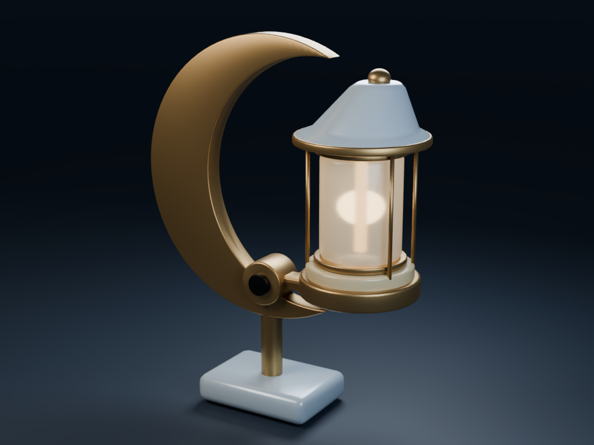
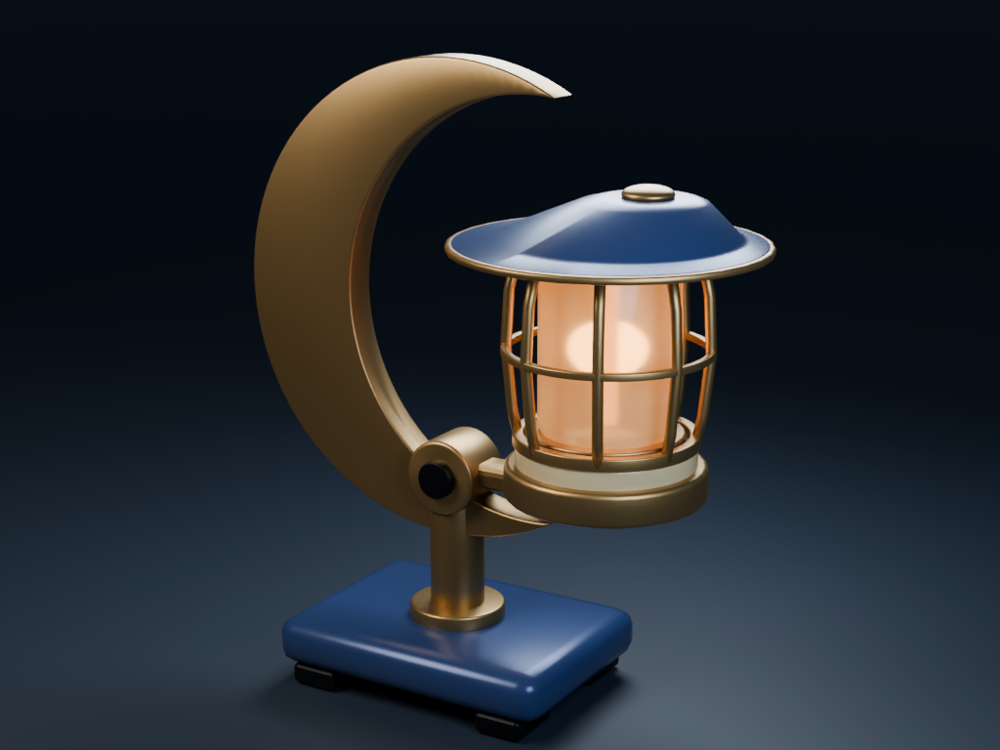

# Night Watch Lantern

One lantern, two uses. The initial design is a pale display piece for an
observatory. The revision gives it a harbor night shift: a lower storm hood,
broader footing, protective ribs and indigo enamel around a warmer light.
The oversized crescent and brass pivot stay.

<table>
  <tr><th width="50%">Observatory display</th><th width="50%">Harbor signal</th></tr>
  <tr>
    <td><a href="before.png"></a></td>
    <td><a href="after.png"></a></td>
  </tr>
</table>

Both images are Blender renders of the included projects. The lantern's parts
remain separate and editable; the camera and studio lighting are included.

## Try the revision

Use **Cavi Blender MCP 0.56.0** and **Blender 5.2.3 LTS** for this example. The
published server needs Python 3.11 or newer. See the
[installation and MCP setup](../../README.md#install).

1. Download [before.blend](before.blend) into your Cavi workspace, which defaults
   to `~/Documents/CaviBlender/`.
2. Start with that file before connecting your agent:

   ```bash
   cavi-blender-mcp runtime start --project before.blend
   ```

   If Cavi is already connected to another project, this command refuses to
   replace it. See [dedicated sessions](../../docs/blender-mcp/source/pages/guides/runtime-and-headless.md)
   for the appropriate setup.

3. Give your connected agent this direction:

   > Keep the oversized crescent and brass pivot. Make this feel like a working
   > harbor signal: lower and widen the storm hood, give it a broader stance,
   > protect the lamp with a ribbed guard, and use indigo enamel with a warmer
   > amber light. Show me the revision before saving a new copy. Leave the parts
   > editable.

4. Review the preview, direct any further changes, then save to a new Blender
   file. Your agent handles Cavi's inspection, edit ownership and native
   operations.

The included [night-watch-lantern.blend](night-watch-lantern.blend) is the
completed harbor version. You can start from that working copy instead and take
the design somewhere else.

## Included files

- [before.blend](before.blend): the initial display lantern.
- [night-watch-lantern.blend](night-watch-lantern.blend): the revised harbor
  lantern, with its editable components and materials.
- [before.png](before.png) and [after.png](after.png): the comparison renders.

The example artwork and source files are covered by the repository's
[MIT license](../../LICENSE).
