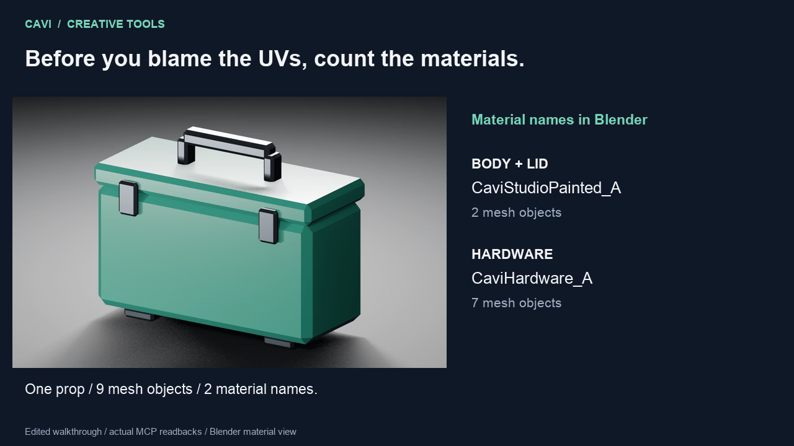

# Count the assigned materials

Why did one prop become two texture sets? Start with the materials assigned to
the exported meshes. This original utility case uses one material for its body
and lid, and another for its handle, latches and feet. The two sets are intentional.

This static handoff was run with Blender MCP 0.44.0, Blender 5.2.3 LTS, Substance
MCP 0.12.0 and Painter 12.2.0 on macOS. Blender exported nine case mesh objects
as a 69,644-byte FBX. Painter opened that exact export path and reported two
texture sets: `CaviStudioPainted_A` and `CaviHardware_A`.

[Watch the 30-second edited walkthrough](utility-case-material-handoff.mp4).
Its material view is a Blender render; the labels report actual MCP readbacks.

## Inputs and observed result

`utility_case.obj` and `utility_case.mtl` are the original editable mesh. Its
source material names are `PaintedMetal` and `Hardware`. `maps-A/` contains
actual Painter base-color, roughness and metalness exports for those materials.
The included standard-library Python generator recreates the original OBJ and
MTL; the geometry was generated from that script, then imported into the apps.
`material-settings.json` contains the fill and studio-view settings.
See [the material-revision example](https://github.com/cavi-ai/substance-mcp/blob/main/examples/painter/uniform-fill-revision/README.md)
for their fill values, A/B comparison and saved-copy recreation steps.

The Blender preview materials were named `CaviStudioPainted_A` and
`CaviHardware_A`. The receiving Painter texture-set names matched these assigned
materials. `results.json` retains the observed versions, file hashes and result.
The source mesh and maps are included; recreate the FBX and editable application
projects in your own workspace.

## Reproduce the handoff

Use the existing [Blender setup](../../README.md#install) and
[Substance setup](https://github.com/cavi-ai/substance-mcp#install). Painter
requires your own licensed installation. Configure both MCPs to use the same
copy of this example as their asset workspace. Create an `exports` parent
directory and choose a new output filename.

1. Call `scene_info`, inspect `session_control`, and claim the current Blender
   project before edits. Preserve other artists' scenes and use an owned
   working scene.
2. Use `asset_io` with `action="import"`, `path="utility_case.obj"`, a unique
   asset `name`, and your current `lease_id`. Retain the returned object names;
   names can differ between sessions.
3. Inspect the returned objects' material slots. Count materials actually used
   by the export selection, rather than every unused material in the scene.
   The case body and lid share `PaintedMetal`; the other seven pieces share
   `Hardware`.
4. Use `assign_material` to bind the matching exported base-color, roughness and
   metalness maps. For the captured handoff, the two assigned material names
   were `CaviStudioPainted_A` and `CaviHardware_A`. Base color uses sRGB;
   roughness and metalness use Non-Color. Run `inspect_mesh_quality` with
   `checks=["materials"]` and inspect the actual paths, slots and color spaces.
5. Export only the nine case meshes through `asset_io`, with `action="export"`,
   the actual returned names, a new `.fbx` path inside `exports`, and your lease.
   Keep the returned path and file. This example does not require LODs,
   collision objects, animation or baking.
6. Inspect Painter's status and ownership. Use an idle, owned project session;
   preserve any other open project. Create a project from the returned FBX
   path through `project`, with OpenGL normals, 1024 texture resolution and
   `source_precision="16"`. Wait until `project action="wait_ready"` reports
   ready before continuing.
7. Inspect `texture_sets`. The captured export produced exactly
   `CaviStudioPainted_A` and `CaviHardware_A`. Compare the names with your own
   assigned materials. If they differ, inspect that assignment and export
   selection before changing UVs or deleting materials.

Follow each application's ownership guide if loading changes its project
identity. Release only your own leases afterward. If an operation reports an
unknown outcome, inspect the application and files before another mutation.

## What the check establishes

The receiving application produced two texture sets from this static FBX.
Separately, the painted body and lid's source-UV check reported zero overlap
pairs or degenerate triangles and passed the chosen two-pixel padding target at
1024×1024. That source-UV check does not certify evaluated/exported UVs, bake
projection, dilation or mip filtering.

Neither result establishes engine import, prefab-reference survival or runtime
performance. Two texture sets can be the correct choice; combining them is an
asset-design decision, not an automatic repair.

The original sample geometry and maps use this repository's MIT license. No
Adobe application, template, preset or Substance project file is included.
